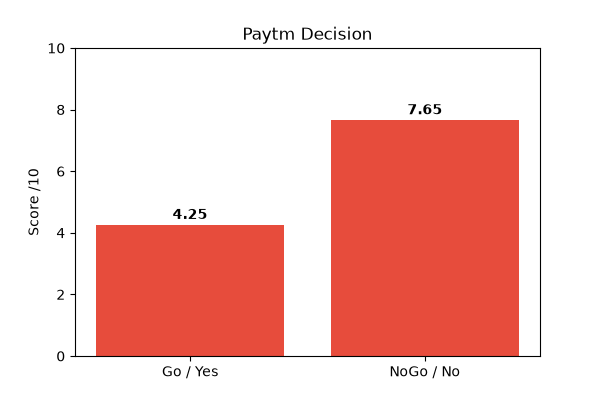

# FLRRC Decision Engine v1.0

> Not a Chatbot. A Decision Calculator.

Converts human confusion into mathematical clarity.

## What is FLRRC?
F - Fact
L - Logic
R - Reasoning
R - Representation (Equation + Graph)
C - Conclusion

## Why different from ChatGPT?
- ChatGPT = Goldfish Memory (Rental Brain)
- FLRRC = Permanent Memory (Own Brain via user_profile.json)

## Output Format
Every decision gives 5 Boxes:
1. FLRRC Breakdown
2. Equation + Probability
3. Graph
4. Risk & Alternatives
5. Next Action

## Branch Strategy
- main -> production
- dev -> development
- feature/* -> new features

## Roadmap
- [x] Setup + Sample 1,2
- [ ] Sample 3,4,5 Gold Template
- [ ] 100 samples dataset
- [ ] Engine + Graph
- [ ] v1.0 Release

## Demo Result - Paytm Case
- **Question:** Paytm 6M unpaid WFO?
- **Equation:** Go=4.25, NoGo=7.65
- **Verdict:** NO-GO (unless PPO confirmed)
- **Graph:** 

## How to Run
python src/engine.py